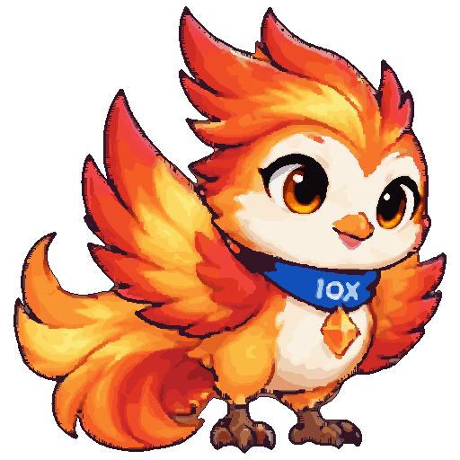
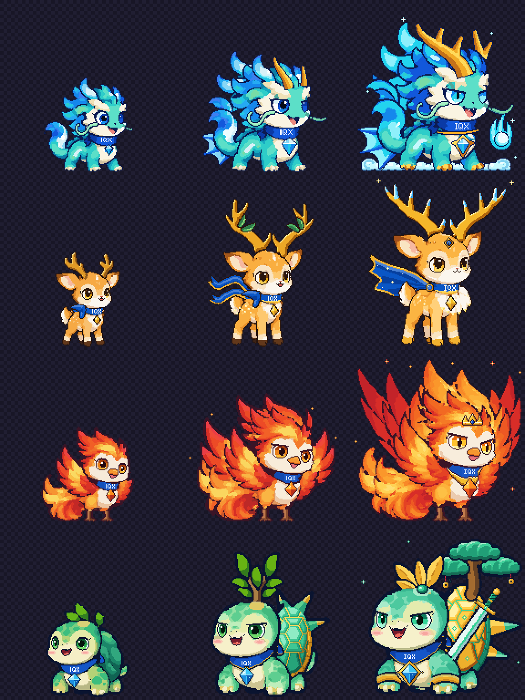

# IQX Pixel Pets

Bản vẽ lại dạng **pixel art 512×512** của 4 linh thú IQX: Thanh Long, Lộc Hươu, Phụng Hoàng, Kim Quy.
Bám sát tranh gốc trong `danhtrongit/IQX` (`frontend/public/assets/mascots-2d/v2/<slug>/poster.webp`),
pixel cứng (không khử răng cưa, không pixel bán trong suốt), palette giới hạn, viền rõ.

| Thanh Long | Lộc Hươu | Phụng Hoàng | Kim Quy |
|---|---|---|---|
|  |  |  |  |

## Bản game: 3 cấp tiến hoá

`game/` chứa bản pixel kiểu game. Mỗi pet có 3 dạng, cùng một canvas 192×192 với chung mặt đất
và chung kích thước pixel, nên pet lớn dần lên khi tiến hoá. Demo chơi được nằm ở `game/index.html`
(mở thẳng file trong trình duyệt là chạy).



| Pet | Hệ | Ấu thể (Lv 1) | Trưởng thành (Lv 10) | Thần thú (Lv 25) |
|---|---|---|---|---|
| Thanh Long | Dòng tiền | Tiểu Thanh Long | Thanh Long Lưu Thủy | Thanh Long Vương |
| Lộc Hươu | Nội bộ | Tiểu Lộc | Kim Lộc | Thần Lộc Thiên Nhãn |
| Phụng Hoàng | Tin tức | Tiểu Phụng | Hỏa Phụng | Thần Hỏa Phượng Hoàng |
| Kim Quy | Định giá | Tiểu Quy | Ngọc Quy | Kim Quy Thần Kiếm |

Demo có: chọn pet, nhịp thở và chớp mắt, cho ăn, luyện tập, dùng kỹ năng, nút "+5 cấp",
hoạt cảnh tiến hoá (bóng trắng nhấp nháy, loé sáng, hộp thoại chúc mừng), hào quang thần thú,
bảng chuỗi tiến hoá, lưu tiến độ trong trình duyệt và âm thanh chiptune (bật/tắt được).

| Đường dẫn | Nội dung |
|---|---|
| `game/pets/<slug>.py` | Thiết kế từng dạng: tên, lore, kỹ năng, chỉ số, `compose()` vẽ ở mức tranh, `touchup()` chỉnh pixel, `blink()` nhắm mắt |
| `game/sprites/<slug>-<n>.png` | Sprite dạng n (192×192), kèm `-blink.png` |
| `game/data/pets.js` | Dữ liệu cho demo, sinh tự động |
| `tools/gamekit.py`, `tools/drawkit.py` | Canvas chung cho các stage và bộ vẽ cho dạng tiến hoá |

```bash
python3 tools/build_game.py                     # build cả 4 pet + game/data/pets.js
python3 tools/build_game.py kim-quy --lineup /tmp/kq.png      # gốc + 3 dạng, phóng 3x
python3 tools/build_game.py kim-quy --zoom 3 40 20 150 120 --out /tmp/z.png   # soi vùng
```

## Thư mục (bản 512)

| Đường dẫn | Nội dung |
|---|---|
| `sprites/<slug>.png` | Sprite chính 512×512, PNG indexed (màu 0 trong suốt) |
| `dist/<slug>@2x.png` | Phóng 1024×1024 nearest-neighbor cho màn hình retina |
| `dist/compare/<slug>.png` | So sánh gốc / pixel |
| `dist/sheet.png` | 4 linh thú trên một hàng |
| `reference/<slug>.webp` | Tranh gốc 1024px dùng làm mẫu |
| `pets/<slug>.py` | Thông số + chỉnh tay riêng cho từng con |
| `tools/` | Pipeline chuyển đổi và công cụ soi |
| `preview.html` | Trang xem nhanh, bật/tắt bản gốc |

## Build

Cần Python 3 với `numpy` và `Pillow`.

```bash
python3 tools/build.py              # cả 4 con
python3 tools/build.py kim-quy      # một con
python3 tools/build.py --size 128   # bản pixel thô hơn (bỏ qua chỉnh tay), xem thử
```

Cách hoạt động (`tools/pixelize.py`):

1. Cắt sát nhân vật, thu nhỏ kiểu box về 512px.
2. Alpha cứng (≥50% là đặc) và một vòng viền 1px bên ngoài.
3. Các nét mực tối trong tranh gốc được giữ thành một màu viền duy nhất.
4. Giảm màu bằng k-means trong không gian Lab.
5. Lọc đa số 3×3 và gộp các mảng màu nhỏ để vùng màu phẳng, sạch.
6. `pets/<slug>.py` → `touchup(art)` vẽ lại bằng tay những chi tiết pipeline làm hỏng
   (chữ IQX, đá quý, mắt, má hồng, râu, gạc...).

## Chỉnh sửa

Soi một vùng (toạ độ sprite 0–511) cạnh bản gốc, có lưới toạ độ:

```bash
python3 tools/inspect_region.py loc-huou 180 120 330 240 --zoom 4 --out /tmp/mat.png
```

Rồi sửa `pets/<slug>.py`: `CONFIG` để đổi thông số pipeline, `touchup(art)` để vẽ tay
(`art.put`, `art.rect`, `art.ellipse`, `art.line`, `art.replace`, `art.blit`, hoặc sửa thẳng `art.idx`).
